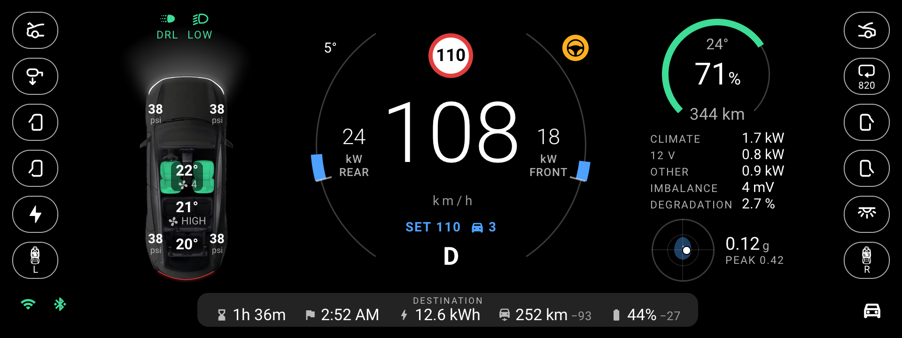
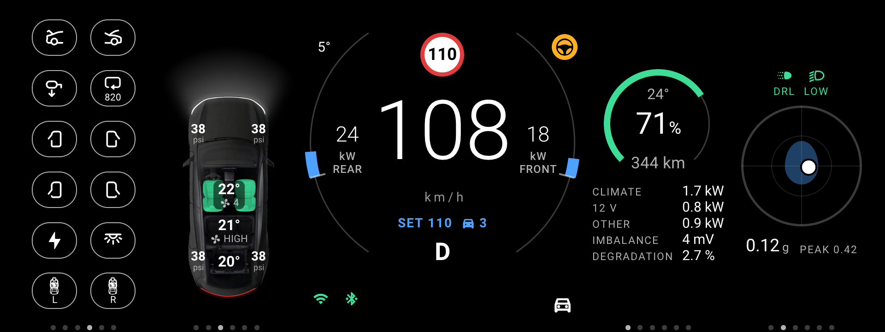
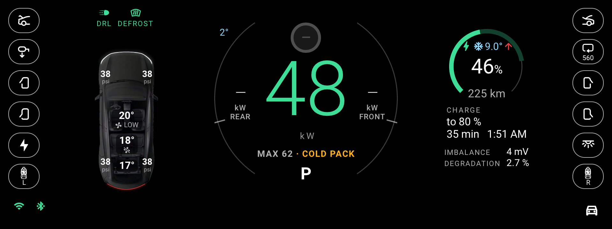
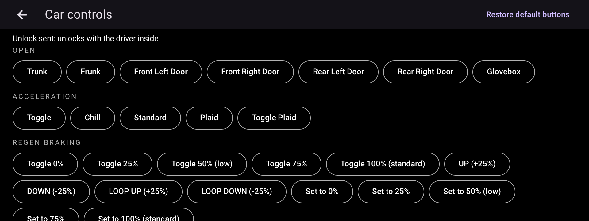
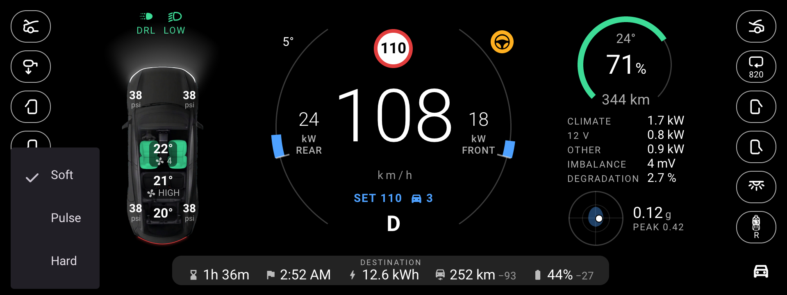
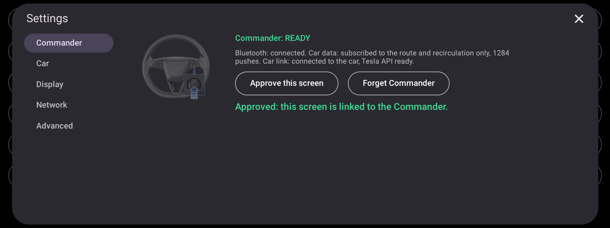
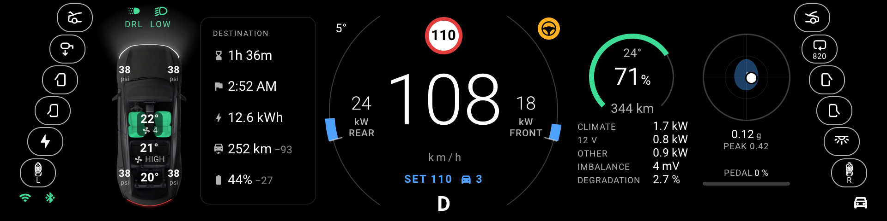

# Wattline — embedded head units

[](https://github.com/cchvuth/wattline-embedded/releases)
[](https://github.com/cchvuth/wattline-embedded/releases)
[](https://github.com/cchvuth/wattline-embedded/releases)

- `app/` — LVGL head-unit application (dashboard UI, wireless Android Auto receiver and its video decoder), one source
  for every device: `app/device/<name>.mk` holds what differs
- `os/`  — Buildroot firmware for the T113 Dash, Enhauto's S3XY Dash (kernel, packages, overlays; R0–R4)
- `os-f133/` — Buildroot firmware for the SRNUBI T313D screen (Allwinner F133), started from its SD card (a card image, like the Dash's): see [os-f133/README.md](os-f133/README.md)

The phone app with the same dash is [cchvuth/wattline](https://github.com/cchvuth/wattline) (Android): it shows
the car's data on the phone, and this repository puts the same dash on a car screen.

## What it looks like

The screenshots are demo data, drawn at the screen's own size.

| Driving | Basic layout | Charging in the cold |
|---|---|---|
|  |  |  |

| Car controls: every S3XY function | Seat massage | Settings: linked to the Commander |
|---|---|---|
|  |  |  |

On the T113 Dash, Enhauto's S3XY Dash (its narrower panel):



## Install it (no computer skills needed)

Wattline runs from a memory card, so nothing on your screen is changed: take the card out and the screen starts its
own software again, just as before.

**You need**
- one of the two screens: the **SRNUBI T313D** (11.26", Allwinner F133) or Enhauto's **S3XY Dash** (an Allwinner T113 inside: the T113 Dash in this repo);
- a **microSD card**, 8 GB or more (everything on it is erased);
- a computer with a card reader, and the free **[balenaEtcher](https://etcher.balena.io)**;
- an **S3XY Commander** in the car: the dash gets the car's data and presses its buttons through it.

**Steps**
1. **Download the card image.** Open the [releases page](https://github.com/cchvuth/wattline-embedded/releases) and
   pick the newest release for your screen:
   - SRNUBI T313D: *Wattline F133 screen* → the file `wattline-f133-sdcard-<version>.img.xz`;
   - S3XY Dash: *Wattline T113* → the file `sdcard.img.xz`.

   Leave the file as it is (no need to unzip it).
2. **Put it on the card.** Put the microSD card in the computer, open balenaEtcher, click **Flash from file** and pick
   the file you downloaded, click **Select target** and pick the card (check its size, so you don't pick another disk),
   then **Flash!** It takes a few minutes. When it says it is done, take the card out.
3. **Put the card in the screen** and turn the car on (or power the screen). The first start takes about a minute
   longer: it prepares the rest of the card for your settings.
4. **Pick your car** when the screen asks (Model Y, Model Y L or Model 3).
5. **Link the Commander.** Tap the Bluetooth icon at the bottom of the dash: Settings opens and the screen asks the
   Commander (or tap **Approve this screen** there). When the screen says so, double-press the **right scroll wheel** on
   the steering wheel. It then says *Approved*.
6. **Car data over Wi-Fi** (optional, more data and faster): with the Commander's ScanMyTesla mode on, the screen joins
   its Wi-Fi (`S3XY_OBD`) by itself. Without it, the dash runs on Bluetooth alone and hides what Bluetooth can't give.

**Updates** come over the internet: tap the Wi-Fi icon, then **Advanced → Software update**, or switch on
**Automatic updates**. The screen needs a network with internet for this (your home Wi-Fi, or a phone's hotspot): it
never downloads over the car's adapter. An update that doesn't start properly is undone at the next start.

**Going back** to the screen's own software: turn it off and take the card out.

**Android Auto** (optional, for advanced users) needs a Google-signed head-unit certificate of your own: see
[Android Auto certificate](#android-auto-certificate). Without one the dash works fully, without the Android Auto
button.

The rest of this page is for developers.

## Android Auto certificate

Wireless Android Auto requires a **Google-signed head-unit certificate**: the phone pins Google's Android Auto CA, so a self-signed certificate is rejected at the TLS handshake ("communication error 7"). Supply your own `aa.crt` / `aa.key` (PEM).

Place them on the Dash at — and they persist across reboot **and** reflash (`/data` is a separate partition):

```
/data/wattline/aa.crt    # PEM certificate (leaf; append the CA chain if the phone wants it)
/data/wattline/aa.key    # PEM private key   (chmod 600)
```

How to put the files there:

- **Over SSH** (enable SSH in **Settings → Advanced**, pair a key):
  ```
  scp aa.crt aa.key root@<dash-ip>:/data/wattline/
  ```
- **Or** power off, take the card out, and mount its data partition (ext4, label `DASHDATA2`) on a computer, then copy the files into `wattline/`.

No certificate ships with the Dash, and none is generated: the on-screen **Android Auto** button (bottom-right of the dashboard) appears only once a Google-signed certificate is in place. A self-signed certificate (phones reject it) is set aside at boot as `aa.crt.unusable` / `aa.key.unusable`. One whose `aa.key` is missing, passphrase-protected, or belongs to another certificate (or that cannot be read) is left in place, but the button stays hidden until it is fixed and the Dash restarts. `aa certcheck /data/wattline/aa.crt /data/wattline/aa.key` says which (exit 1 self-signed, 2 the key, 3 no readable certificate). Android Auto left on by its button comes back on after a restart. Tapping the button starts Android Auto.

## How to build

### Dash app (`app/`)

1. The signal tables (`app/build/signals_gen.h`, `app/build/test_decode.c`) are generated from the Flutter app ([cchvuth/wattline](https://github.com/cchvuth/wattline)) and committed. With the app cloned as `wattline/` in the repo root or next to this checkout, `make` regenerates them from it; a signal is changed there, then the regenerated files are committed here.
2. LVGL is fetched, not committed: `git clone --depth 1 -b v9.6.0 https://github.com/lvgl/lvgl app/third_party/lvgl-9.6.0`.
3. Host: `mkdir -p app/build && make -C app test` (unit tests) and `make -C app -f app.mk host` (the UI on the desktop).
4. ARM, with the firmware's Buildroot toolchain: `make -C app -f app.mk ARM_CC=<buildroot>/host/bin/arm-buildroot-linux-gnueabihf-gcc CMDR=1 arm` → `app/build/arm-app-cmdr/dash` (and `dash.stripped`). Use the toolchain of the tree that built it: a copied/relocated Buildroot host tree fails to link libc, even with `--sysroot`.

Icons and pictures (`app/ui/gen/`) are rendered from the Flutter app: `APP=<flutter app checkout> app/ui/assets/export.sh` (needs `flutter` and python3 with Pillow).

Android Auto receiver self-test (no phone needed; TLS-in-frames, messages, split-frame reassembly, the Bluetooth handshake):

```
cc -O2 -Wall -DAA_BT $(pkg-config --cflags gio-2.0 gio-unix-2.0) -o aa app/aa/aa.c app/core/pb.c \
   -lssl -lcrypto $(pkg-config --libs gio-2.0 gio-unix-2.0) && ./aa --selftest
```

### Firmware image (`os/`)

Buildroot 2026.02 in a Docker container (`debian:stable`), with a persistent volume for the Buildroot tree and its output. Container packages: `build-essential make rsync pkg-config file bc cpio python3 git wget unzip` (plus `libssl-dev libglib2.0-dev` for host builds of the receiver).

Mounts the build expects: `os/` at `/ext` (the `BR2_EXTERNAL` tree), `app/` at `/native` (the dash program and the Android Auto receiver are built from it), and `os/radio/` at `/radio` (the RTL8733BS Wi-Fi driver source, Realtek's vendor driver, GPL-2.0: see [os/radio/README.md](os/radio/README.md)). CI builds and tests the app and the firmware's tools, not the image (a full Buildroot build).

```
make O=<output dir> BR2_EXTERNAL=/ext dash_r4_defconfig
make O=<output dir>
```

Rebuild single packages in an existing output tree: `make BR2_EXTERNAL=/ext wattline-aa-rebuild spike-vdec-rebuild` (run in the output dir).

After a change to the kernel's configuration (any `os/board/dash/linux-r*.fragment`), its patches (`os/board/dash/patches*/linux/`) or its version, run `make BR2_EXTERNAL=/ext linux-dirclean rtl8733bs-dirclean rtl8733bs-cc-dirclean` before `make`. Buildroot applies the patches only when it unpacks the kernel. The Wi-Fi modules are built outside the kernel, and one built for the old kernel still loads, after which Wi-Fi is gone.

### Private additions

The author's own unit runs a few additions kept in a private repository, because they need files that can't be published. They aren't in this repository, its releases or its update bundles. Nothing here depends on them, and a build from this repository is complete without them.

### Updating a running Dash

The root filesystem is an initramfs: it runs from RAM and is read back from the card at every boot, so a file copied onto a running Dash is gone after a power cycle. To make a change stay:

- **Replace the image**: put a new `rootfs.cpio.uboot` on the card's boot partition (p1, FAT), keeping the old one as `rootfs.cpio.uboot.prev` to roll back.
- **Or use the overlay** (images from v0.2.0 on): put the file under `/data/overlay/root/` at its path on the Dash (e.g. `/data/overlay/root/usr/bin/aa`) and write the image's `/etc/image-id` to `/data/overlay/image-id`. `S05overlay` copies the overlay over the root at boot, and drops an overlay made for a different image, so it never shadows newer firmware.

### Over-the-air updates

Cards burned from v0.3.0 on update themselves from this repo's releases (`dash-update`; Settings → Advanced → Software update, with an automatic option). The factory image on the boot partition is never rewritten: an update is unpacked into a slot on `/data` (`/data/boot/A` or `B`) and starts at the next power-up, on trial. A version that does not run healthy for 30 s within 3 starts is rolled back by U-Boot to the last good one, and automatic updates skip it from then on. The Dash only looks for updates with internet access (never on the car's adapter network), and installs nothing that is not signed with the project's key.

To publish an update, build the image, then make the release's update assets and upload everything in the folder to the release:

```
os/board/dash/mk-ota.sh <output dir>/images <private key> <release folder>
```

This writes `wattline-ota-<version>.tar.gz` (the version comes from the image's own `/etc/image-id`), then `SHA256SUMS` over every file in the folder (put `sdcard.img.xz` and the F133's `wattline-f133-sdcard-<version>.img.xz` there first) and `SHA256SUMS.sig` (Ed25519). A release carries both devices' bundles (the F133's `os-f133/board/f133/mk-ota.sh` writes into the same folder first): each updater reads only the 20 latest releases, so a run of releases for one device would hide the other's. The private key is never in the repo or a release; the image carries only its public half (`os/board/dash/wattline-ota.pub.raw`). Tests, each run in a scratch container (see their headers): `os/board/dash/test/dash-update-test.sh` (the updater against a local HTTPS release server) and `os/board/dash/test/dash-scr-test.sh` (the boot script in U-Boot's sandbox).

## License

MIT ([LICENSE](LICENSE)) for this project's own code. The kernel and U-Boot patches, the panel and touch drivers and
the kernel modules are GPL-2.0, like the code they belong to. Third-party code keeps its own licence (see each one's
header or LICENSE file): LVGL (fetched at build time), the Wi-Fi drivers and their firmware, the fonts, and the
F133's DRAM init in its U-Boot patches (Allwinner's, from xfel). The F133's `/init` (`os-f133/board/f133/init/init.c`,
GPL-2.0-or-later) is linked with dosfstools' `fsck.fat` (GPL-3.0, fetched by Buildroot at build time), so that binary
as a whole is GPL-3.0.

Provided as is, without warranty: not for safety-critical use, and installing it may void the device's warranty. Not
affiliated with or endorsed by Tesla or Enhauto; S3XY Dash and S3XY Commander are Enhauto products.
